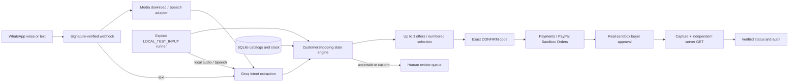

# OmataPay

**WhatsApp-oriented, voice-first AI shopping: compare merchants, confirm your choice, and verify payment.**

OmataPay aims to let a shopper describe a product in a WhatsApp voice note, compare available merchant offers, select a numbered option, confirm the exact purchase, and pay through PayPal Sandbox. AI interprets the request; stored catalog records determine products, prices and stock. Uncertain or custom requests go to human review.

- **Published demonstration:** [Watch the 2:50 hackathon video](https://youtu.be/MQ8jolZpS8E).
- **Repository:** [stanley07/omata-paypal-hackathon-2026](https://github.com/stanley07/omata-paypal-hackathon-2026).
- **Public application demo URL:** no verified public application URL was available for this documentation update. The published video is the public demonstration; local application access is **http://127.0.0.1:8000**.
- **License:** [MIT](LICENSE), preserved from the existing repository.

> **Source availability:** this documentation-only update does not publish the local shopping/WhatsApp additions. The public source at the preceding commit `73235b2` contains the original merchant dashboard, AI interpretation and PayPal payment engine. `app/demo.py`, `app/shopping.py`, `app/catalog.py`, `app/whatsapp.py`, `app/readiness.py` and their new tests remain local, uncommitted additions. The shopping commands below are verified against that existing local workspace; they cannot yet be reproduced from a fresh public clone. Publishing those implementation changes is a remaining judging/reproducibility blocker, not a completed step.

## What is implemented and what has been demonstrated

| Capability | Implementation and evidence boundary |
| --- | --- |
| Merchant dashboard, accounts, order drafts, explicit review/approval, audit and payment history | Implemented in the published baseline; original application footage appears in the video. |
| Natural-language merchant proposals | Configurable live interpretation adapter plus an explicitly labeled deterministic development parser. The deterministic mode is not AI. |
| Customer shopping state engine | Implemented locally: intent, up to three merchant offers, numbered selection, exact confirmation, stock reservation, checkout and verification. Local test-input demonstration completed. |
| Three fictional catalogs | Sunrise Pantry, River Market and Copper Basket; nine sample products across milk, rice and coffee. |
| Groq Whisper transcription and Groq interpretation | Real provider calls independently tested earlier. Voice capability was tested separately; this does not establish a voice-to-payment WhatsApp transaction. |
| PayPal Sandbox OAuth, checkout, capture and independent GET verification | Implemented; a recorded USD 5.80 local shopping transaction completed and was verified. No live-money settlement is claimed. |
| WhatsApp adapter | Local implementation includes signed webhook intake, media download, audio transcription and outbound transport. A Meta dashboard-generated messages test succeeded, according to the operator. |
| Real WhatsApp-to-OmataPay routing | **Not end-to-end verified.** A real customer message reached the shared test number, but Omata AI responded, not OmataPay. A genuine WhatsApp voice-note-to-payment transaction has not been proven. |
| Human review | Custom/uncertain shopping requests enter the existing review queue; no invented price or automatic checkout. |

The Meta OmataPay app was published, as reported by the operator. App publication and a dashboard test do not prove correct real-customer routing. Do not change shared production Omata AI receivers, Meta callbacks/WABA subscriptions or Cloudflare configuration to reproduce this local demo.

## Architecture



The WhatsApp path is implemented locally but its genuine inbound route remains unverified. The recorded payment used the clearly identified **LOCAL_TEST_INPUT** path, with local replies instead of real WhatsApp sends. The runner reuses `CustomerShopping`, `GroqIntent`, `Speech`, `Payments` and `PayPal`; it does not impersonate a Meta webhook.

The baseline uses FastAPI, SQLite and httpx. `app/paypal.py` fixes financial requests to `https://api-m.sandbox.paypal.com`; there is no configurable live-PayPal mode. `app/payments.py` owns checkout creation, durable request IDs, buyer-approval checks, capture and independent verification. Local `app/shopping.py` owns conversation state and catalog purchasing. The application uses one sandbox recipient, not separate merchant payouts.

## Windows PowerShell setup

Prerequisites: Windows PowerShell, Git, Python 3.11 or newer (`py -3`), and internet access for dependency installation. Provider-enabled demonstrations additionally need your own authorized Groq credentials and PayPal Sandbox application plus a separate sandbox buyer. The local runner needs no Meta credentials and no public tunnel. FFmpeg is not needed to run the application.

For a new checkout:

```powershell
git clone https://github.com/stanley07/omata-paypal-hackathon-2026.git
Set-Location .\omata-paypal-hackathon-2026
py -3 -m venv .venv
.\.venv\Scripts\python.exe -m pip install -r requirements.txt
.\.venv\Scripts\python.exe -m pip install python-dotenv==1.2.4
```

For the existing development checkout, start here instead of cloning or replacing it:

```powershell
Set-Location 'C:\Users\ezebo\Documents\OmataAI_Development\omata-paypal-hackathon-2026'
```

The explicit `python-dotenv` installation supports Uvicorn's `--env-file` option even when using the published baseline requirements. The local requirements already declare it. Configure your own private environment; never reuse another operator's credentials or database. Preserve any existing `.env`:

```powershell
if (-not (Test-Path -LiteralPath .env)) {
    Copy-Item -LiteralPath .env.example -Destination .env
}
```

Edit the private file locally or use a secure process-environment launcher. Do not paste secrets into command arguments, shell history, logs, screenshots or Git. `.env.example` is documentation; never put credentials there. Existing process variables override values loaded from `.env`, so use a clean shell when switching configurations.

### Configuration names

Only variable names are listed here; no operator-specific values or credentials are published.

| Purpose | Environment-variable names |
| --- | --- |
| Application origin and cookie policy | `APP_BASE_URL`, `COOKIE_SECURE` |
| Sandbox checkout and verification | `PAYPAL_ENABLED`, `PAYPAL_CLIENT_ID`, `PAYPAL_CLIENT_SECRET` |
| Optional PayPal webhook verification | `PAYPAL_WEBHOOK_ID` |
| Customer catalog shopping (local additions) | `CUSTOMER_SHOPPING_ENABLED` |
| Groq shopping intent (local additions) | `GROQ_ENABLED`, `GROQ_API_KEY`, `GROQ_MODEL` |
| Voice transcription (local additions) | `SPEECH_ENABLED`, `SPEECH_ENDPOINT`, `SPEECH_MODEL`, `SPEECH_API_KEY` |
| WhatsApp transport only (local additions) | `WHATSAPP_ENABLED`, `WHATSAPP_ACCESS_TOKEN`, `WHATSAPP_APP_SECRET`, `WHATSAPP_VERIFY_TOKEN`, `WHATSAPP_PHONE_NUMBER_ID`, `WHATSAPP_MERCHANT_ID`, `WHATSAPP_GRAPH_VERSION` |
| Optional merchant proposal AI, separate from shopping intent | `AI_PROVIDER`, `AI_ENABLED`, `AI_ENDPOINT`, `AI_MODEL`, `AI_API_KEY` |

Feature gates use the exact lowercase boolean value `true` to enable calls; default gates are off. For an authorized local text-shopping run, enable PayPal and Groq and privately configure their required credentials/model. Audio additionally requires enabled speech and its endpoint/model/key. The generic speech endpoint must accept multipart model, response format and audio file fields and return a JSON transcript. The runner invokes the shopping engine directly, so its isolated flow does not depend on the application's customer-shopping or WhatsApp gate.

For web application catalog shopping, enable the customer-shopping gate; startup seeds catalogs additively. Use a loopback application origin for the local server. A future HTTPS origin requires secure cookies. Neither application startup nor sample seeding makes a payment/provider request. The optional PayPal webhook ID is unnecessary for the runner's explicit PAID/STATUS verification path.

### Start the application

```powershell
.\.venv\Scripts\python.exe -m uvicorn app.main:create_app --factory --env-file .env --host 127.0.0.1 --port 8000 --no-access-log
```

Open **http://127.0.0.1:8000** using the exact configured origin. `GET /health` is the health route. Register your own local merchant account; passwords must be 12-128 characters. The existing application creates its own `data/omata.db`. Do not point it at a production Omata AI database. Do not launch another process on port 8000 when a server is already running.

The default merchant parser accepts `5 cartons of milk at USD 25 each`. This creates a draft for review, not a payment and not a live AI result. Merchant approval is separate from checkout creation. Real AI proposals require their separate configuration. The local shopping demo below uses the shopping-intent adapter instead.

`--no-access-log` avoids logging Meta's GET verification query token if that optional integration is later configured. The app does not implicitly load `.env`; loading here is explicitly performed by Uvicorn.

## Reproduce the local shopping demonstration

**Availability gate:** these commands require the existing local shopping modules noted above. In a fresh public clone they are currently absent. This check fails explicitly instead of implying the docs-only commit contains them:

```powershell
if (-not (Test-Path -LiteralPath .\app\demo.py)) {
    throw 'The local shopping implementation has not yet been published in this documentation-only revision.'
}
.\.venv\Scripts\python.exe -m app.demo --help
```

The following are operator instructions, not automatic startup actions. Inputs with `--allow-sandbox` can call configured providers; an exact confirmation can create a real **sandbox** order. Use only test credentials and simulated funds.

Initialize once and retain the UUID. This creates a new schema and fictional catalogs under `artifacts/shopping-demo/<UUID>/shopping.db`; it never writes the operational `data/omata.db`:

```powershell
$demoRun = & .\.venv\Scripts\python.exe -m app.demo init
.\.venv\Scripts\python.exe -m app.demo inspect --run $demoRun
```

Send a clearly labeled local text request:

```powershell
.\.venv\Scripts\python.exe -m app.demo input --run $demoRun --env-file .env --allow-sandbox --text 'I want two cartons of milk. Show me options.'
```

Alternatively, replace that input with your own non-PII M4A recording of the request. This calls the real configured speech adapter; no customer audio file is supplied by the public repository:

```powershell
.\.venv\Scripts\python.exe -m app.demo input --run $demoRun --env-file .env --allow-sandbox --audio .\my-demo-request.m4a
```

The engine returns up to three merchants when stock and intent match. It never pads missing offers. For the initial sample catalogs and a generic two-carton milk request:

| Option | Fictional merchant | Product | USD each | USD total for 2 |
| --- | --- | --- | ---: | ---: |
| 1 | River Market | Low-fat milk, 1 litre carton | 2.90 | 5.80 |
| 2 | Sunrise Pantry | Whole milk, 1 litre carton | 3.20 | 6.40 |
| 3 | Copper Basket | Lactose-free milk, 1 litre carton | 4.10 | 8.20 |

Read the actual offers before selecting. Explicit product constraints, transcription or stock changes can produce different results.

```powershell
.\.venv\Scripts\python.exe -m app.demo input --run $demoRun --env-file .env --allow-sandbox --text 'option 1'
```

Review the product, merchant, quantity and total. Replace `ACTUAL_CODE` with the exact code just returned; do not reuse a historical code. Offers/confirmation expire after 15 minutes:

```powershell
.\.venv\Scripts\python.exe -m app.demo input --run $demoRun --env-file .env --allow-sandbox --text 'CONFIRM ACTUAL_CODE'
```

**Stop at the genuine PayPal Sandbox approval URL.** Open it manually and approve with a separate sandbox buyer. The runner does not automate or invent buyer approval. Only after that approval:

```powershell
.\.venv\Scripts\python.exe -m app.demo input --run $demoRun --env-file .env --allow-sandbox --text 'PAID'
.\.venv\Scripts\python.exe -m app.demo input --run $demoRun --env-file .env --allow-sandbox --text 'STATUS'
.\.venv\Scripts\python.exe -m app.demo inspect --run $demoRun
```

PAID checks remote approval before capture; STATUS performs independent verification. Accept completion only with a verified capture ID and verification timestamp. The browser return page alone changes nothing. The runner uses loopback return URLs; on another buyer device the return page may not load, so return manually to the operator terminal.

Sanitized evidence is written to `artifacts/shopping-demo/<UUID>/evidence.jsonl`. Raw inputs and normal engine audit records stay in the private isolated database. Custom/uncertain requests enter that database's human-review queue; they do not appear in the operational dashboard and no automatic custom-order approval is added.

After an uncertain failure, inspect and reconcile first. Do not create a replacement order or new run to bypass uncertainty. Only an explicitly reconciled retry should use:

```powershell
.\.venv\Scripts\python.exe -m app.demo retry --run $demoRun --env-file .env --allow-sandbox --reconciled
```

This reuses the pending message and durable payment request IDs. No real WhatsApp messages are sent by any runner command.

## Recorded USD 5.80 Sandbox result

The published video shows an evidence graphic labeled **Recorded local shopping run / PayPal Sandbox**, not a live WhatsApp screenshot. The existing record identifies:

| Field | Recorded result |
| --- | --- |
| Transport | LOCAL_TEST_INPUT; no WhatsApp delivery |
| Merchant / selection | River Market (fictional sample), option 1 of 3 |
| Purchase | 2 low-fat milk cartons at USD 2.90 each; total USD 5.80 |
| Local order ID | `e3173081-5478-4d37-a525-ca28f7270465` |
| PayPal Sandbox order ID | `82143997YU6651836` |
| Verified capture ID | `1W0918623B1140712` |
| Final status | COMPLETED |
| Server verification time | 2026-11-12 16:39:25 UTC |

The operator completed real sandbox buyer approval, capture and server-side verification. Buyer-browser interactions were not filmed. The saved evidence was audited against the isolated run before video production; no new payment was made for documentation or filming. Transaction identifiers above are sanitized evidence identifiers, not credentials. Private evidence databases are intentionally not in Git.

Any USD 125 dashboard/audit footage is a **separate historical transaction**. It must not be conflated with the USD 5.80 purchase. Neither transaction establishes genuine WhatsApp voice-note-to-payment routing.

## Confirmation, reliability and security

- Exact customer confirmation precedes catalog checkout. Price/ownership/stock changes are rechecked; stock reservation and local order creation are atomic. Custom/uncertain intent goes to review.
- Merchant accounts and authenticated routes enforce ownership; passwords are hashed, sessions are server-side, browser writes require origin/CSRF checks, and HTTPS requires secure cookies.
- The local WhatsApp receiver checks raw-body HMAC signatures and configured receiving-number identity. Duplicate-message handling, leases and uncertain-send protection prevent blind replay; status acceptance is not proof of message delivery.
- The payment engine persists idempotency keys, checks real buyer approval before capture, and independently matches order reference, amount, currency and completed capture. A timeout is uncertain, not permission to start over. Old uncertain creates require reconciliation.
- Secrets and provider responses are withheld from error output. Media is size-limited, held in memory, and fetched only from an allowed HTTPS host with redirects disabled.
- `.gitignore` excludes `.env`/private env variants, `data/`, `artifacts/`, database files, logs, virtual environments and caches. `.env.example` is the non-secret exception. Personal audio and other media are not universally ignored: keep them outside Git and never use a broad staging command for this demo.
- SQLite and synchronous provider processing are suitable for this sandbox demonstration, not a claim of production scale. A production rollout needs durable queueing, retention policy and operational reconciliation. No fulfillment, refunds or multi-seller settlement are demonstrated.

## Tests and static validation

From the project root, after installing dependencies:

```powershell
.\.venv\Scripts\python.exe -m pytest -q
.\.venv\Scripts\python.exe -m ruff check app tests
```

The published baseline test is `tests/test_application.py`. In the full local workspace, focused shopping/WhatsApp/runner tests are also available:

```powershell
.\.venv\Scripts\python.exe -m pytest -q tests/test_whatsapp.py tests/test_shopping.py tests/test_demo.py tests/test_readiness.py
```

These tests mock external providers and are not live payment or webhook evidence. Earlier local records report 116 passing tests before runner additions and seven focused runner tests passing. This documentation update does not claim a new full-suite run. A public clone will have fewer tests until the local additions are published.

## Judging notes and license

Start with the [published film](https://youtu.be/MQ8jolZpS8E), then inspect the published payment engine and run the baseline locally. The local shopping reproduction and its source-publication gap are documented explicitly above. Older documents can predate later successful provider tests; use this README and the film's evidence boundaries for the current submission status.

Existing supporting documentation: [setup](SETUP.md), [architecture](docs/ARCHITECTURE.md), [sandbox procedure](docs/REAL_SANDBOX.md), [tests](docs/TESTING.md), and [originality](docs/ORIGINALITY.md).

The existing **MIT License** is preserved unchanged: Copyright (c) 2026 Omata Pay contributors. The broader Omata AI concept predates this hackathon; OmataPay's sandbox application is separate. Production Omata AI services and credentials are not part of this repository or demo.
