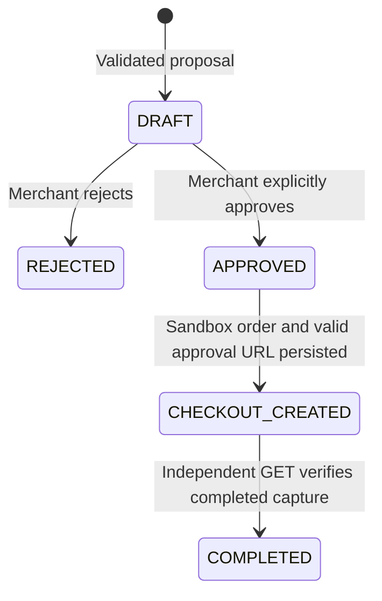

# Architecture and security

## Components

`app/main.py` exposes same-origin HTTP routes and static assets. `security.py` hashes passwords with scrypt and opaque session tokens with SHA-256; the browser receives only an HttpOnly, SameSite=Lax session cookie. Sessions expire in eight hours, logout revokes them, and POSTs require an exact origin plus a session CSRF token. Authentication attempts are persisted and limited per IP/email pair. `config.py` limits HTTP to loopback and rejects databases outside this project.

`db.py` uses Python's SQLite driver with bound SQL parameters, foreign keys, short write transactions and unique constraints. `BEGIN IMMEDIATE` serializes state changes across processes. Every order query is merchant-scoped; attempts to access another merchant's order return 404. Passwords, session tokens, provider keys, source prompts and raw API responses are not written to audit logs.

`interpretation.py` provides deterministic and configurable AI adapters. Both go through the same Decimal validator: integral quantity 1–10,000, price with at most two decimal places, total at most 1,000,000 and USD/EUR/GBP only. The limited currency set avoids guessing unsupported PayPal decimal precision. There is no FX conversion, tax, discount or multi-item inference. The optional customer reference is supplied by the merchant; no contact information is invented.

`paypal.py` owns all external payment HTTP calls. TLS verification remains enabled; redirects and environment proxies are disabled; requests time out after 20 seconds. OAuth tokens stay in memory and refresh before expiration or once on a 401. Errors omit provider response bodies, headers, credentials and customer text. The SDK-free REST adapter has one fixed sandbox origin.

`payments.py` owns durable payment operations and completion verification. No network call holds a SQLite transaction open. The UI renders API-derived text with escaping and uses a restrictive self-only CSP, without CDN scripts or fonts.

## State machine

Browser return/cancel endpoints only serve HTML. They never update status or capture. After buyer approval, the authenticated owning merchant selects **Capture & verify**. The server first checks PayPal's order status, captures only an APPROVED remote order, and independently fetches the remote order afterward. This deliberately avoids automatically capturing from an untrusted return URL. Merchant refresh loads local records; **Check status** explicitly performs remote verification.

Completion requires the expected remote order ID, exactly one purchase unit, matching local custom reference, amount and currency, exactly one COMPLETED final capture with matching amount/currency, and a unique capture ID. Capture responses and webhook payload claims alone are insufficient. Duplicate completion produces no second completion audit record. Completed local records never regress based on stale remote data.

## Retry and recovery

Each local order has one persistent UUID request ID per create/capture operation. A 180-second database lease prevents concurrent operations during normal request timeouts; process crashes leave the key durable and permit retry after lease expiration. PayPal receives the same `PayPal-Request-Id` on every retry. Create attempts older than five hours are blocked conservatively because upstream idempotency retention is finite. There is no unsafe “reset payment” button.

On an uncertain capture, a fresh GET can recover a completed payment. A later retry always GETs before another capture; it reuses the capture request ID if PayPal still reports APPROVED. SQLite unique constraints prevent shared remote orders, repeated capture IDs and duplicate webhook event records. Database corruption, manual database edits, provider inconsistency and upstream retention expiration still require operator reconciliation.

## Webhooks

The receiver is exempt from browser CSRF checks but requires all signature headers and a configured webhook ID. It sends the event and headers to PayPal's sandbox `verify-webhook-signature` endpoint; only SUCCESS continues. It does not fetch the certificate URL itself. A verified event is matched by remote order ID, followed by independent GET verification. Event deduplication and order updates commit in the same database transaction. Failures do not mark an event processed, allowing delivery retry. Unknown verified events are acknowledged without changing orders. Webhooks never authorize initial order creation or automatically capture.

## Explicit limitations before any production use

- Local single-machine demonstration, not production audited. SQLite is not encrypted; operating-system access controls protect it. Audit entries are application records, not tamper-evident evidence against database administrators.
- All local merchants use the operator's one sandbox recipient application. This is tenant isolation of local data, **not** PayPal multiparty seller onboarding or separate settlement accounts. Real merchant onboarding is out of scope.
- No refunds, disputes, reversals, partial captures, tax, FX, inventory, password reset, MFA or email verification. “COMPLETED” records a historically verified capture, not perpetual settlement assurance; refund/reversal reconciliation needs a separate ledger design.
- No public signup abuse defense beyond the local authentication limiter; no distributed rate limiting, public webhook DoS controls, TLS termination or operations monitoring. Keep bound to loopback.
- Financial endpoints remain intentionally gated. Live OAuth, actual response shapes, buyer checkout, capture and webhook delivery require the manual real sandbox run.
- AI output may be wrong despite schema validation. Human review remains mandatory; no model is trusted to execute a payment.
- UI/browser accessibility and responsive appearance require visual verification; automated backend tests cannot establish usability.
